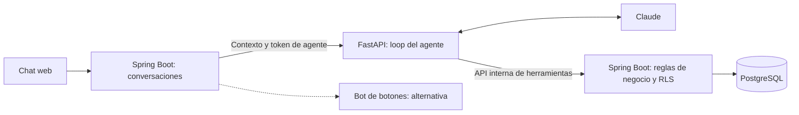

# Recepta — Plataforma de gestión de turnos con IA

Plataforma SaaS de gestión de turnos que integra un asistente conversacional basado en inteligencia artificial, capaz de consultar disponibilidad y gestionar reservas mediante tool calling.

El proyecto combina una arquitectura Full Stack con técnicas de ingeniería de IA: integración de LLMs, ejecución controlada de herramientas, evaluaciones automatizadas, guardrails y observabilidad.

**El modelo propone, el backend decide.**

[Demo en vivo](https://recepta-wheat.vercel.app/login) · [English version](README.md)

## Problema y solución

Recepta centraliza la gestión de turnos para barberías y permite a sus clientes consultar disponibilidad, reservar, cancelar o reprogramar desde un chat web. El backend valida las operaciones con las reglas de negocio del sistema.

## Funcionalidades

- Agenda, disponibilidad, profesionales y servicios.
- Administración de clientes y dashboard de actividad y ventas.
- Asistente conversacional web con herramientas para gestionar turnos.
- Configuración del asistente por establecimiento, con entorno de pruebas.
- Bot de botones como alternativa cuando la IA no está disponible.

## Arquitectura



Spring Boot es responsable de los datos, la autorización y las reglas de negocio. El servicio de IA no accede directamente a PostgreSQL.

- Herramientas tipadas con Pydantic y loop propio con límites de ejecución.
- Operaciones mediante prepare/commit y política de confirmación según la precisión de la solicitud.
- Aislamiento por establecimiento mediante Row-Level Security y autenticación JWT.
- Límites de solicitudes, presupuesto global y por establecimiento, y comprobaciones acotadas de horarios y precios.
- Registro de modelo, versión de configuración y prompt, tokens, coste, latencia y resultado.

[Arquitectura del asistente](docs/ai-architecture.md) · [Decisiones de arquitectura](docs/adr/)

## Evaluación del asistente

Resultados documentados el 18/11/2026, versión del prompt `2026-11-18.3`.

| Modelo | Escenarios superados | Coste promedio por escenario | Latencia promedio por escenario |
|---|---:|---:|---:|
| Claude Haiku 5.5 | 29/29 (100%) | USD 0,00054 | 3,9 s |

Los escenarios utilizan un core simulado, verificaciones deterministas y un LLM juez para evaluar el tono. Las métricas corresponden al escenario completo, no a cada mensaje individual ni a producción.

[Metodología y reproducción de evaluaciones](docs/evaluations.md)

## Stack tecnológico

| Capa | Tecnologías |
|---|---|
| Backend | Java 21, Spring Boot 4, JWT |
| Frontend | React, TypeScript, Vite |
| IA | Python 3.13, FastAPI, Pydantic, Claude |
| Datos | PostgreSQL 16, Row-Level Security, Flyway |
| Infraestructura | Docker Compose, nginx |
| Evaluaciones | pytest, escenarios YAML, verificaciones deterministas, LLM-as-a-Judge |

## Ejecución local

Requisitos: Docker con Compose. La clave de Anthropic es opcional para ejecutar el proyecto sin IA.

```bash
docker compose up -d --build
```

Abrir http://localhost:8081. Para activar la IA, definir `ANTHROPIC_API_KEY` en el entorno antes de iniciar Compose. Para crear el primer establecimiento, configurar el Super Admin según la guía de instalación.

[Instalación, variables y alta inicial](docs/setup.md) · [Despliegue de la demo](DEPLOY.md)

## Estructura del repositorio

- `backend/`: API REST, dominio y motor de conversación.
- `frontend/`: dashboard y chat público.
- `ai-service/`: agente, herramientas, pruebas y evaluaciones.
- `docs/`: documentación técnica y decisiones de arquitectura.

## Alcance y estado

Proyecto de portfolio con demo pública y datos de demostración; no se presentan métricas de uso comercial.

El chat web es el canal de IA implementado. La integración de WhatsApp dispone de una interfaz de proveedor, pero el adaptador real está pendiente; el proveedor de desarrollo solo registra mensajes salientes. La ventana de cancelación es configurable y su valor de negocio sigue pendiente de validación.

La propuesta de arquitectura original conserva el contexto de diseño y distingue decisiones futuras: [propuesta de arquitectura de IA](propuesta-arquitectura-ia.md). Las funcionalidades pos-MVP incluyen roles adicionales, acceso de profesionales, depósitos, lista de espera, campañas, reprogramación masiva y ampliación de la gestión de sucursales y rubros.

## Documentación

- [Instalación y configuración](docs/setup.md)
- [Arquitectura del asistente](docs/ai-architecture.md)
- [Evaluaciones](docs/evaluations.md)
- [Despliegue](DEPLOY.md)
- [Decisiones de arquitectura](docs/adr/)

[Portfolio](https://francoamarilla.github.io/portfolio/) · [LinkedIn](https://www.linkedin.com/in/franco-maximiliano-amarilla/)
