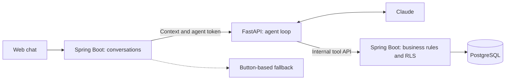

# Recepta — AI-Powered Appointment Management

SaaS appointment management platform featuring an AI-powered conversational assistant capable of checking availability and managing bookings through tool calling.

The project combines a full-stack architecture with AI engineering techniques: LLM integration, controlled tool execution, automated evaluations, guardrails, and observability.

**The model proposes; the backend decides.**

[Live Demo](https://recepta-wheat.vercel.app/login) · [Versión en español](README.es.md)

## Problem and solution

Recepta centralizes appointment management for barbershops and lets customers check availability, book, cancel or reschedule appointments through a web chat. The backend enforces the system's business rules for each operation.

## Features

- Calendar, availability, professionals and services.
- Customer management and activity and sales dashboard.
- Conversational web assistant with appointment-management tools.
- Per-business assistant configuration and testing playground.
- Button-based fallback when AI is unavailable.

## Architecture



Spring Boot owns the data, authorization and business rules. The AI service never accesses PostgreSQL directly.

- Pydantic-typed tools and a custom bounded agent loop.
- Prepare/commit operations and a confirmation policy based on request precision.
- Tenant isolation using Row-Level Security and JWT authentication.
- Rate limits, global and per-tenant budgets, and limited time and price grounding checks.
- Model, configuration and prompt versions, tokens, cost, latency and outcome logging.

[Assistant architecture](docs/en/ai-architecture.md) · [Architecture decisions](docs/adr/) (Spanish)

## Assistant evaluations

Documented run: November 18, 2026; prompt version `2026-11-18.3`.

| Model | Passed scenarios | Mean cost per scenario | Mean latency per scenario |
|---|---:|---:|---:|
| Claude Haiku 5.5 | 29/29 (100%) | USD 0.00054 | 3.9 s |

Scenarios use a simulated core, deterministic checks and an LLM judge for tone. Metrics apply to the entire scenario, not each individual message or production traffic.

[Evaluation methodology and reproduction](docs/en/evaluations.md)

## Tech stack

| Layer | Technologies |
|---|---|
| Backend | Java 21, Spring Boot 4, JWT |
| Frontend | React, TypeScript, Vite |
| AI | Python 3.13, FastAPI, Pydantic, Claude |
| Data | PostgreSQL 16, Row-Level Security, Flyway |
| Infrastructure | Docker Compose, nginx |
| Evaluations | pytest, YAML scenarios, deterministic checks, LLM-as-a-Judge |

## Local setup

Requirements: Docker with Compose. An Anthropic key is optional when running without AI.

```bash
docker compose up -d --build
```

Open http://localhost:8081. To enable AI, set `ANTHROPIC_API_KEY` in your environment before starting Compose. Configure a super admin to create the first tenant as explained in the setup guide.

[Setup, environment variables and first tenant](docs/en/setup.md) · [Demo deployment guide](DEPLOY.md) (Spanish)

## Repository structure

- `backend/`: REST API, domain and conversation engine.
- `frontend/`: dashboard and public chat.
- `ai-service/`: agent, tools, tests and evaluations.
- `docs/`: technical documentation and architecture decisions.

## Scope and status

Portfolio project with a public demo and demonstration data; no commercial usage metrics are claimed.

Web chat is the implemented AI channel. WhatsApp integration has a provider interface, but a real adapter is still pending; the development provider only logs outbound messages. The cancellation window is configurable and the appropriate business value remains pending validation.

The [original AI architecture proposal](propuesta-arquitectura-ia.md) (Spanish) preserves design context and future decisions. Post-MVP features include additional roles, professional logins, deposits, waitlists, campaigns, bulk rescheduling and expanded branch and business-type management.

## Documentation

- [Setup and configuration](docs/en/setup.md)
- [Assistant architecture](docs/en/ai-architecture.md)
- [Evaluations](docs/en/evaluations.md)
- [Deployment](DEPLOY.md) (Spanish)
- [Architecture decisions](docs/adr/) (Spanish)

[Portfolio](https://francoamarilla.github.io/portfolio/) · [LinkedIn](https://www.linkedin.com/in/franco-maximiliano-amarilla/)
