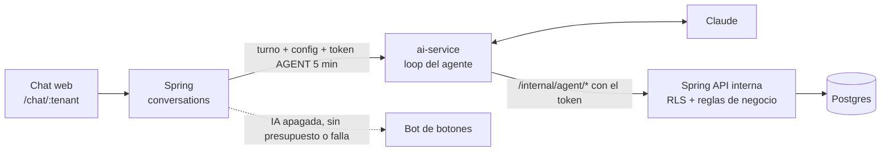

# Arquitectura del asistente de IA

[English version](en/ai-architecture.md) · [README](../README.es.md)

## Asistente de IA

| Variable | Dónde | Default | Uso |
|---|---|---|---|
| `AI_SERVICE_URL` | backend | vacío (IA apagada: el chat usa el menú de botones) | URL de `ai-service` |
| `AI_SERVICE_TOKEN` | backend y ai | **sin default** en ai (rechaza todo) | Secreto compartido de las llamadas backend → ai |
| `AI_DAILY_BUDGET_USD` | backend | `0` (sin tope) | Tope global diario de gasto en LLM, todos los tenants |
| `CHAT_RATE_LIMIT_PER_MINUTE` | backend | `20` | Mensajes por minuto por IP y por sesión en el chat público |
| `TURNSTILE_SECRET` | backend | vacío (sin captcha) | Cloudflare Turnstile en sesiones nuevas del chat. El frontend necesita `VITE_TURNSTILE_SITE_KEY` |
| `FORWARD_HEADERS_STRATEGY` | backend | `none` | `framework` detrás de un proxy (Render), para que el rate limit vea la IP real |
| `ANTHROPIC_API_KEY` | ai | — | Clave del proveedor |
| `AI_MODEL` / `AI_EFFORT` | ai | `claude-haiku-5-5` / `low` | Modelo y nivel de effort del agente |
| `CORE_BASE_URL` | ai | `http://localhost:8080` | Dónde está el backend (para `/internal/agent/*`) |

### Solo del perfil `demo`

El perfil `demo` (la demo pública: ver `DEPLOY.md`) se activa **únicamente**
con `SPRING_PROFILES_ACTIVE=demo`. Sin esa variable, las clases de seed y el
endpoint de reseteo no se cargan y `/api/demo/reset` responde 404 — hay un
test que lo verifica (`DemoProfileAbsentTest`).

| Variable | Default | Uso |
|---|---|---|
| `DEMO_ADMIN_EMAIL` / `DEMO_ADMIN_PASSWORD` | vacío (no siembra nada) | Credenciales del admin del tenant de demo |
| `DEMO_RESET_TOKEN` | vacío (endpoint apagado, 404) | Token de `POST /api/demo/reset`, en el header `X-Demo-Reset-Token` |
| `DEMO_SEED_ON_STARTUP` | `true` | `false` no regenera los datos al arrancar |
| `DB_POOL_MAX` | `5` | Tamaño máximo del pool Hikari |

En el frontend, `VITE_API_BASE_URL` apunta la SPA a otra URL de API (por
default `/api`, mismo origen), y `VITE_DEMO_EMAIL` / `VITE_DEMO_PASSWORD`
hacen aparecer el cartel con las credenciales en el login. Sin definirlas,
no hay cartel.

## Asistente de IA

Un agente con herramientas, no un "chat con contexto": el modelo consulta y propone acciones con tool calling, y **el backend decide**. Propuesta de diseño (incluye elementos futuros) en [`propuesta-arquitectura-ia.md`](../propuesta-arquitectura-ia.md); las decisiones clave, en [`docs/adr/`](adr/).

- **Herramientas** (`ai-service/app/tools.py`): info del local, servicios, profesionales, disponibilidad, identificar cliente, mis turnos, perfil, reservar/cancelar/reprogramar en dos pasos (`prepare_*` + `commit_*`) y derivar a una persona. El tenant, la conversación y el cliente salen del token y de la base, nunca de lo que escribe el modelo.
- **Precisión medida por código** (`BookingDraftResolver`): el modelo pasa las palabras literales del cliente ("el jueves", "tipo 10") y Spring decide si reserva directo (AUTO) o pide confirmación (CONFIRM). Un borrador CONFIRM solo se confirma si hay un mensaje del cliente posterior al borrador.
- **Configuración del dueño** versionada (pantalla **Asistente**): nombre, tono, voseo, emojis, políticas, qué puede hacer, modo de confirmación, presupuesto mensual. Se prueba en un playground (reservas simuladas) antes de publicar.
- **Guardrails**: límite de mensajes por IP/sesión, captcha opcional, tope diario global y presupuesto mensual por local; horarios y precios de la respuesta se verifican contra lo que devolvieron las herramientas (regenera una vez, después recorta). Si la IA no está disponible, el mismo bot de botones de WhatsApp atiende por la web.
- **Chat para el cliente**: pantalla estilo WhatsApp en `/chat/:tenantId`, con historial y opción "Nueva conversación". Para la web del local hay un widget: `` agrega un botón flotante que abre el chat en una ventana emergente (demo en `/widget-demo.html?tenant=...`). En el panel, el dueño prueba su asistente desde el botón flotante de abajo a la derecha.
- **Observabilidad**: una fila por turno en `ai_turn` (modelo, versión de prompt y de config, tokens, costo, latencia, resultado) y una línea JSON de traza por turno en los logs de `ai-service`.

## Implementación

El [loop del agente](../ai-service/app/agent.py) limita cada turno a seis iteraciones y cada llamada a 1500 tokens de salida. Las [herramientas tipadas](../ai-service/app/tools.py) utilizan Pydantic y la API interna del backend. Las lecturas pueden ejecutarse en paralelo; si hay una escritura, las herramientas se ejecutan secuencialmente.

El chequeo de grounding de horarios y precios es acotado; no constituye una garantía general contra alucinaciones o ataques de prompt injection.

Ver [evaluaciones](evaluations.md).
