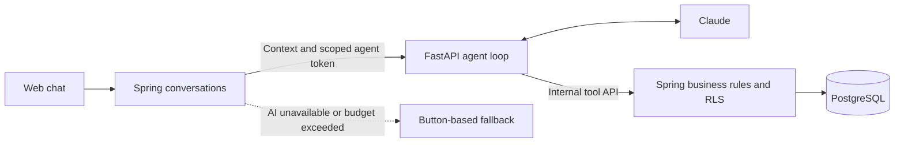

# AI assistant architecture

[Versión en español](../ai-architecture.md) · [README](../../README.en.md)

The model proposes; the backend decides. Spring Boot owns business data and validates actions; the Python service orchestrates the model and tools.

## Tool execution and booking

The [typed tool registry](../../ai-service/app/tools.py) uses Pydantic and calls the internal Spring API. Tools cover business information, services, professionals, availability, customer identification, appointments, profile, booking, cancellation, rescheduling and human handoff. Tenant and conversation identity come from the scoped token; customer identity is resolved by the backend.

Booking, cancellation and rescheduling use prepare/commit operations. Spring resolves literal customer expressions and determines whether a request can execute directly or needs confirmation. A confirmation draft requires a subsequent customer message.

The [agent loop](../../ai-service/app/agent.py) permits at most six iterations and 1500 output tokens per model call. Reads may run concurrently; when a write is present, execution is sequential.

## Configuration and safeguards

- Versioned owner configuration: assistant identity, tone, policies, capabilities, confirmation mode and monthly budget; a playground allows testing with simulated bookings before publishing.
- Rate limits, optional CAPTCHA, global daily and tenant monthly budgets.
- Limited grounding checks for hours and prices, one regeneration attempt and removal of unsupported values if needed. This is not a general guarantee against hallucination or prompt injection.
- The web chat falls back to the button-based conversation engine when AI is unavailable.

## Observability

Each AI turn stores model, prompt and configuration versions, tokens, cost, latency and outcome in the backend. The AI service emits a structured JSON trace per turn.

## Channel and scope

The web chat is the implemented AI channel, including an embeddable widget. The WhatsApp provider is abstracted, but the real adapter remains pending; the development provider only logs outbound messages.

See [evaluations](evaluations.md), [architecture decisions](../adr/) and the [original design proposal](../../propuesta-arquitectura-ia.md) (Spanish; includes future design ideas).
